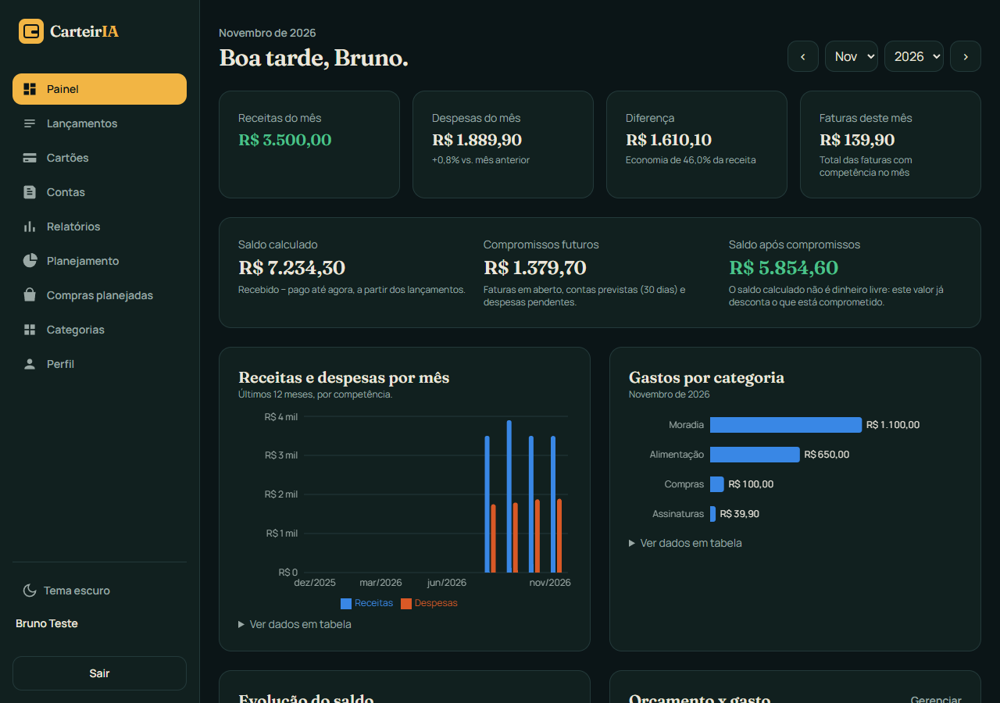
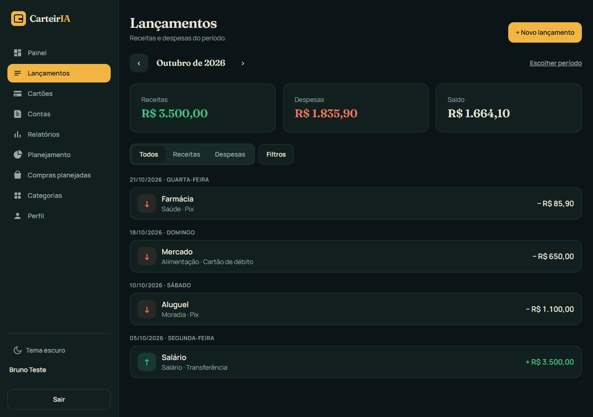
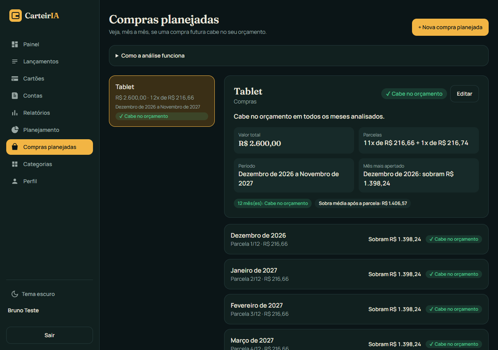

# CarteirIA

Sistema web de controle financeiro pessoal, com várias contas de usuário e os dados de cada pessoa isolados no próprio banco de dados.

Com ele dá para registrar receitas e despesas, controlar cartões (parcelas, faturas e assinaturas), contas fixas, orçamentos e metas, ver relatórios com gráficos e simular se uma compra parcelada cabe no orçamento dos próximos meses.

> **Situação:** projeto pessoal em fase de testes. Roda localmente e tem 292 testes no backend e 28 no frontend. Ainda não está publicado na internet e **ainda não tem IA**: a arquitetura foi preparada para isso, mas é o próximo passo.

## Funcionalidades

- Cadastro com confirmação de e-mail, login, recuperação de senha, sessões e exclusão da conta
- Lançamentos de receitas e despesas com categorias, filtros e totais
- Cartões: compras parceladas, faturas por mês, pagamento total ou parcial e assinaturas mensais
- Contas fixas (mensal, bimestral, trimestral, semestral ou anual)
- Painel com 5 gráficos e relatórios comparativos
- Orçamentos por categoria com alertas, metas de economia e exportação em CSV/ZIP
- **Compras planejadas:** análise mês a mês se a parcela de uma compra futura cabe no orçamento
- Painel de administração (aprovar cadastros, convites, suspender contas), com verificação em duas etapas obrigatória para o admin

## Tecnologias

| Parte | Tecnologias |
|---|---|
| Frontend | React, TypeScript, Vite, Tailwind CSS, Recharts |
| Backend | Python, FastAPI, SQLAlchemy, Alembic, Argon2 (senhas), PyOTP (verificação em duas etapas) |
| Banco | PostgreSQL 16 com Row-Level Security |
| Testes | Pytest (contra PostgreSQL real), Vitest e Testing Library |
| Infra | Docker Compose, Caddy (HTTPS), Mailpit (e-mails em desenvolvimento) |

## Como rodar localmente

Pré-requisitos: Docker Desktop, Python 3.11+ e Node.js 20+.

```powershell
# 1. Configuração: copie o modelo e preencha (senhas e SECRET_KEY gerados por você)
copy .env.example .env

# 2. Banco e caixa de e-mail local
docker compose --env-file .env up -d

# 3. Backend
cd backend
python -m venv .venv
.\.venv\Scripts\pip install -r requirements-dev.txt
.\.venv\Scripts\alembic upgrade head
.\.venv\Scripts\python -m uvicorn app.main:app --host 127.0.0.1 --port 8000

# 4. Frontend (outro terminal)
cd frontend
npm install
npm run dev
```

- Site: http://localhost:5173
- E-mails de teste (confirmação, senha, convites): http://localhost:8025
- Documentação da API: http://localhost:8000/api/docs

No Windows, o `iniciar.ps1` faz os passos 2 a 4 de uma vez (depois da primeira instalação).

**Testes**

```powershell
cd backend;  .\.venv\Scripts\python -m pytest
cd frontend; npm test
```

## Estrutura de pastas

```
CarteirIA/
├── backend/
│   ├── app/
│   │   ├── api/routes/     rotas da API (auth, lançamentos, cartões, contas, relatórios, admin...)
│   │   ├── models/         tabelas (SQLAlchemy)
│   │   ├── security/       senhas, tokens, verificação em duas etapas, limite de tentativas
│   │   └── services/       regras de negócio e cálculos financeiros
│   ├── alembic/versions/   migrações do banco (tabelas e regras de RLS)
│   └── tests/              testes com Pytest
├── frontend/
│   └── src/                páginas, componentes, cliente da API e testes
├── docker/postgres/        criação dos usuários do banco com privilégios mínimos
├── scripts/                backup e restauração
├── docs/prints/            prints das telas (conta com dados fictícios)
├── docker-compose.yml      ambiente de desenvolvimento
└── docker-compose.prod.yml ambiente de produção (com HTTPS)
```

## Exemplos (dados fictícios)

**Compra parcelada no cartão:** R$ 1.200,00 em 12x gera R$ 100,00 em cada fatura. Se a divisão não for exata, a diferença de centavos vai para a última parcela (ex.: R$ 100,00 em 3x = 2x de R$ 33,33 + 1x de R$ 33,34).

**Compra planejada:** um tablet de R$ 2.600,00 em 12x aparece como "11x de R$ 216,66 + 1x de R$ 216,74". Para cada mês, a tela mostra a receita, os compromissos, quanto sobra depois da parcela e uma conclusão: *Cabe no orçamento*, *Cabe com atenção*, *Acima do orçamento* ou *Dados insuficientes*.

**Prints**

<!-- Tire os prints com a conta fictícia (ver dados de exemplo) e salve em docs/prints/ -->
| Painel | Lançamentos | Compras planejadas |
|---|---|---|
|  |  |  |

## Decisões e limitações

- Cada usuário só enxerga os próprios dados, e isso é garantido pelo PostgreSQL (Row-Level Security), não só pela API. A API usa um usuário de banco sem privilégios de administrador.
- Os valores usam `Decimal`/`NUMERIC`, nunca `float`, para não perder centavos.
- O sistema não se conecta a bancos nem cartões: tudo é registrado pelo usuário.
- A análise de compras planejadas é uma estimativa baseada na média dos últimos meses, não uma garantia.

## Próximos passos

- Publicar uma versão de testes fechada
- Adicionar um assistente com IA que use os serviços do backend já existentes

## Licença

Código sob a licença MIT: veja [LICENSE](LICENSE). As bibliotecas de terceiros seguem as próprias licenças, listadas em [THIRD_PARTY_NOTICES.md](THIRD_PARTY_NOTICES.md).

Desenvolvido por Paulo Leão, com apoio do Claude Code.
